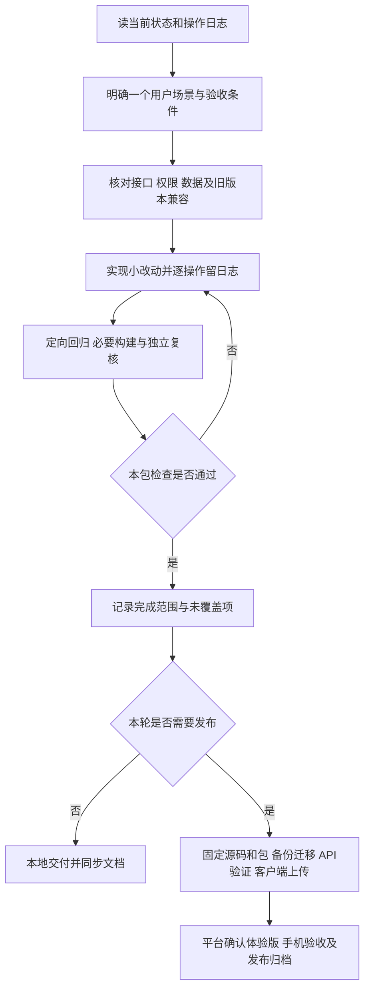

# Weculture 后续开发流程

制定日期：2026-10-25。基线为已确认的API022／体验版`0.8.20261025.1`；这是开发规划，尚未启动下列新功能。原[逐步改进计划](Weculture小程序逐步改进计划.md)继续保存整体需求，本文件给出执行次序及每包退出条件。

> 2026-11-01状态：P1举报治理、P2a运营精选、P2b最小事件统计和P3a文字草稿恢复已完成本地实现与自动检查（API 221项、小程序216项、后台构建和页面编译通过）；P3b–P4只完成设计。**未部署、未执行云端迁移、未上传小程序**；P0真机验收按用户要求统一后置。P2–P4拆分见[工作包拆分](Weculture后续工作包拆分20261101.md)，P1契约见[举报治理设计与交付](Weculture举报治理设计与交付20261101.md)，P2a见[运营精选设计与交付](Weculture运营精选设计与交付20261101.md)，P3a见[草稿恢复设计与交付](Weculture草稿恢复设计与交付20261101.md)，P2b见[最小事件统计设计](Weculture最小事件统计设计20261101.md)，P3b–P4见[详细设计](WecultureP3b-P4设计与依赖20261101.md)。

## 2026-10-26 本轮执行范围（待用户确认）

用户本轮要求先看方案再确认；目前仅核对记录并细化本节，没有启动下列实施。建议这次先完成**0.8关键流程验收与必要修复，同时准备举报治理设计**，后续功能依次单独推进。

1. **先准备可直接执行的验收清单。**按API022／`0.8.20261025.1`固定版本，列出角色、测试样本、预期结果、证据和清理要求。交付逐例验收表、问题清单、数据库核对与隔离验证方案；已有390项本地检查及12次云请求按原范围引用，不重复计数。
2. **优先验收关键链路，有问题先修复。**先检查登录认证与校园权限、评论发表／回复／本人删除、旅行计划重开及跨设备恢复、活动取消再报名与人数一致；随后覆盖分享回流、搜索／作者主页／话题筛选、审核、手动选城和字体。按实际具备的设备、账号和样本逐项执行，不等待所有条件齐全才启动；缺项明确保留“待验证”。修复按独立小包记录并定向回归。
3. **补数据库证据。**先核对计划参数、评论两条迁移的真实记录与已有备份关联，再在隔离环境验证恢复、重复请求、名额竞争和回滚。仅使用明确指定、可清理的测试样本；尚无可用访问路径或隔离环境时，先交付执行方案，不操作真实用户数据，也不把方案写成验证通过。
4. **并行准备下一个功能：举报与后台处理。**先梳理内容／评论举报入口、原因、重复规则、状态、学校／角色权限、后台处理和留痕，复用现有下架／软删除。交付最小需求、接口／数据变更范围及验收条件；本轮先确认这一设计范围，后续再进入实现和配套发布，正式上线前应完成P0关键流程。

**需要配合的条件：**有效0.8体验二维码和体验成员权限；安卓／iPhone及同校、外校、未认证账号；审核角色和指定测试样本；数据库迁移记录的合法读取路径、独立恢复与MySQL验证环境。确认后先推进不依赖这些条件的本地准备；平台既有访问禁止继续遵守，必要人工步骤按实际页面交接，不换路径绕过。

**这次确认边界：**P0验收准备、具备条件后的实际验证及必要修复，加P1举报治理设计。P1实现、生产迁移／部署和客户端更新按后续具体工作包推进；运营精选、事件统计、草稿、多图、活动体验、关注通知及正式审核不在这次一并启动，自动定位仍暂缓。

本次操作见[2026-10-26日志](操作日志/2026-10-26.md)。以下P0—P4保留完整开发顺序和完成标准。

## 下一轮先做什么

先做P0现有版本验收和数据库验证，发现问题就开独立修复包；不在尚未验收的链路上叠加更多功能。验收可与P1的需求设计并行，P1正式上线以前应完成P0关键流程；剩余低优先项明确留档。

## P0｜0.8验收收口与运行验证

**目标：**把“已发布”推进到有实际使用证据，补齐390项本地检查及12次云读取没有覆盖的部分。

执行A：用平台有效二维码，在安卓和iPhone、同校／外校／未认证账号上验证六组新增功能，并回归原有活动、审核和选城：

- 内容与用户搜索、作者主页、话题分页和时间筛选；数量与权限一致，快速切换和过期会话不回填旧结果。
- 评论发表→他人回复→本人删除；非本人不能删除；下架、撤认证、换账号后旧内容与草稿清除。
- 好友分享在已登录、未登录及需认证情况下回流，校园卡不泄露受限内容，旧下架链接不能继续阅读。
- 旅行日期／同行人数保存、关闭重开、重登录及同账号换设备恢复，换账号隔离；弱网重试保持原意图。
- 活动报名→取消→再次报名，在详情和“我的计划”中人数、计划一致；满员、截止、取消状态正确。
- 投稿通过／驳回／下架、手动选城记忆与城市归属、字体和大字号。

执行B：与A并行核对两条新增迁移的真实记录，关联备份任务；在隔离恢复环境演练备份恢复；用独立测试数据验证真实MySQL重复请求、名额竞争和事务回滚。测试样本、账号与清理范围先记录；仅对既有授权覆盖的测试写入执行，缺少指定样本或必要授权时先准备方案，不能随意改真实用户内容。

**产物：**逐例验收记录、问题清单、证据目录、迁移核实结果及恢复／并发报告。用例记录版本、角色、预期、实际、证据、结果及未覆盖原因。

**完成标准：**登录与认证、校园权限、评论／删除、计划恢复、活动人数一致等关键项通过；失败项修复并定向回归。缺少设备、账号或环境时记“待验证”，不以本地检查顶替。二维码获取只影响扫码交接，不改变已经确认的体验版发布状态。

## P1｜内容／评论举报与后台处理闭环

**目标：**增加互动后先补处理问题的能力。

- 先统一举报对象、原因、重复提交、处理状态及权限；内容和评论共用清晰的状态模型。
- API完成创建、查询及受限处理；后台按学校／角色范围查看和处理，记录操作者、动作、原因与时间。
- 小程序提供举报入口、提交反馈；已下架或已删除对象仍有明确结果，不能通过举报接口泄露原内容。
- 处理动作先沿用已有下架／软删除能力，避免一个举报包顺带重构全部审核系统。

**完成标准：**举报→后台处理→前台结果可完整走通；重复、越权、跨校、对象失效及失败重试有回归；可追溯处理记录。涉及新表时先准备迁移和旧数据兼容方案，再配套发布。

## P2｜运营精选与最小事件统计

**目标：**让运营能配置推荐内容，并能判断功能是否被使用。

- P2a精选：明确选择、排序、上下架及权限；内容失效时自动不展示，不把“公开内容按时间排序”称为精选。
- P2b统计：先定义需要回答的问题，再收集搜索→详情、发布完成、审核耗时、评论参与、报名取消及回访等必要事件；建立基线后再设目标。
- 只保留必要事件编码、时间和聚合维度，约定保留周期和访问范围，不收集搜索／评论原文或敏感身份。

**完成标准：**运营修改精选后可见结果符合权限；事件去重、计数口径、失败补报和数据最小化已核对，能回答预先定义的运营问题。P2a、P2b分开检查和发布。

## P3｜创作与活动体验，连续三个小包

1. **草稿恢复：**先补离页／重开后恢复、手动清除、成功发布后清除与账号隔离；不将“当前页面失败保留”当成草稿。
2. **多图与封面：**再做数量／格式／大小限制、顺序与封面选择、部分失败重试和预览；移除与重试不得造成重复内容，明确未使用资源的清理机制。
3. **活动变更与内容关联：**最后补报名后的变更提示、取消说明，以及笔记到活动／路线的真实关联；变更信息和阅读权限以服务端最新状态为准。

**完成标准：**每个小包独立通过离页、断网、重复提交、换账号及再次进入验收，再进入下个小包；不一次打包所有创作需求。

## P4｜关注与通知

先定义关注／取消、通知类型、去重和未读规则；再做站内互动回流。涉及微信订阅消息时另行核对平台能力和用户主动订阅流程，提供关闭入口。

**完成标准：**关注状态幂等；通知可回到有权查看的对象；删除、下架、撤认证和换账号后不泄露内容。治理与数据基线先完成，避免在缺少处理能力时增加互动入口。

## 独立后续事项

- 自动定位按原要求暂缓，权限、隐私指引、平台条件和真机定位单独成包；不阻碍手动选城版本使用。
- 正式后台域名、实际账单与数据库暂停恢复另列运行任务；50元是规划目标，不能当作费用硬封顶。
- 正式版审核另有准入检查；体验版发布确认不等于正式上线。短视频与AI路线等先依据试点反馈决策，不进入当前开发承诺。

## 每个工作包都走同一个流程

设计时先写一个正常场景、一个权限拒绝场景和一个失败恢复场景；有数据变化时补旧数据、重复请求和回退影响。前后端可按已对齐合同并行，涉及同一共享文件或平台操作由一名负责人串行执行。

检查通过后只因代码变化、失败或未解风险补查；不为展示进度反复全量测试。发布前后固定同一份源码，避免“测过的不是上传的”。发现高影响验收问题先修复，再扩展下一包。

每次操作写[逐操作日志](操作日志/2026-10-25.md)，工作包收尾再更新[开发日志](Weculture开发日志.md)、手册当前状态及需求勾选。通用规则见[项目方法](Weculture项目通用方法与防错规范.md)与[环境约定](项目环境与发布约定.md)。
